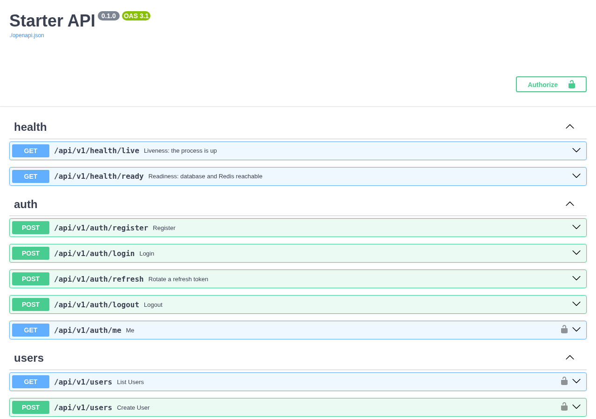
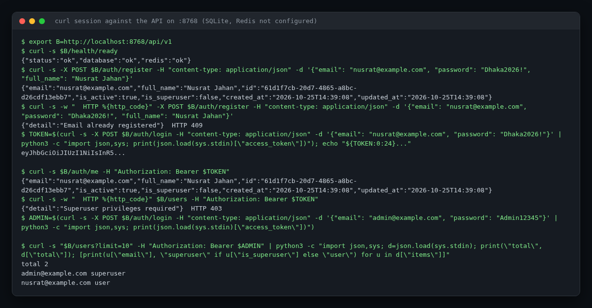
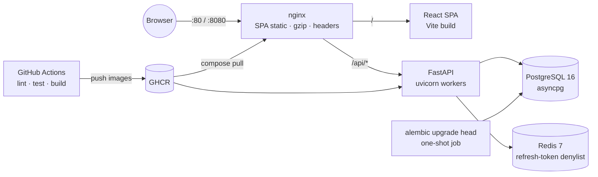

<!-- topics: fastapi,react,typescript,docker,docker-compose,nginx,postgresql,redis,alembic,github-actions,template,boilerplate -->
# Docker FastAPI React Template

A production-shaped starter for full-stack client projects: async FastAPI + Postgres + Redis behind nginx, a React/TypeScript SPA, JWT auth end to end, migrations, tests, CI and a deploy pipeline, all runnable with one `make up`.

[](https://github.com/AkibUllah/docker-fastapi-react-template/actions/workflows/ci.yml)
[](https://github.com/AkibUllah/docker-fastapi-react-template/actions/workflows/codeql.yml)
[](https://github.com/AkibUllah/docker-fastapi-react-template/releases)


## Try it live

| | |
|---|---|
| API reference | https://akibullah.github.io/docker-fastapi-react-template/ — Swagger UI rendered from the exported `openapi.json` (static; the Codespace runs the real service) |
| Run in your browser | [](https://codespaces.new/AkibUllah/docker-fastapi-react-template?quickstart=1) — `docker compose up` with Postgres, Redis, API, Vite and nginx; open port 8080 for the app and sign in with `admin@example.com` / `Admin12345` (created at start-up), or port 8000 for `/api/v1/docs` |
| One-click deploy | [](https://render.com/deploy?repo=https://github.com/AkibUllah/docker-fastapi-react-template) — API, SPA, free Postgres and Key Value from `render.yaml`; you choose the first superuser's email and password at deploy time |
| Local | `cp .env.example .env && make up` (see Quick Start) |

## Screenshots



*API reference on GitHub Pages, rendered from the exported OpenAPI document.*



*A real curl session against the API on a local port (SQLite, no Redis): registration, the 409 on a duplicate email, JWT login, and the superuser-only users list (403 for a normal user, paginated for the start-up admin).*

## Why this exists

Every client engagement I have started spent its first week on the same plumbing: an API skeleton with auth, a database that migrates instead of being recreated, a frontend that talks to it without CORS surprises, a compose file that works on a teammate's laptop, and a CI pipeline that fails before a broken build reaches a server. This template is that first week, written once and kept honest by tests. It encodes the decisions I keep making for payment and e-commerce backends (async I/O, refresh-token rotation, structured logs with request IDs, nginx in front) and leaves the domain code empty on purpose.

## Features

- **Backend**: FastAPI with async SQLAlchemy 2.0 (asyncpg in production, aiosqlite in tests), Alembic migrations with an async `env.py`, pydantic-settings configuration, JWT access + rotating refresh tokens with a Redis denylist, bcrypt passwords, users CRUD with self/superuser authorisation, `/health/live` and `/health/ready`, JSON logs with `X-Request-ID` propagation, ruff + mypy strict
- **Frontend**: Vite 5 + React 18 + TypeScript strict + Tailwind, TanStack Query, React Router, react-hook-form + zod forms, axios client that attaches the token and performs a single shared refresh on 401, auth provider, protected and superuser-only routes, login / register / dashboard / profile / users pages, vitest + Testing Library
- **nginx**: one origin for SPA and API, gzip, security headers (CSP, nosniff, frame-ancestors), SPA fallback, immutable caching for hashed assets, `/api` proxy with forwarded headers; dev config also proxies the Vite HMR websocket
- **Docker**: `docker-compose.yml` for development (hot reload for both services, Postgres 16, Redis 7) and `docker-compose.prod.yml` (multi-stage images, non-root users, healthchecks, one-shot `migrate` service)
- **Automation**: Makefile targets for the whole lifecycle, GitHub Actions CI (backend on Python 3.10/3.11, frontend on Node 18/20, image builds), a `deploy.yml` example that pushes to GHCR and runs `compose pull && up` over SSH, pre-commit config
- **Scripts and docs**: dependency-free `wait-for-it.sh`, `create_superuser.py`, three ADRs explaining the architecture choices

## Architecture



Key decisions (full write-ups in [`docs/adr/`](docs/adr)):

- **Async all the way down.** I/O-bound APIs spend their time waiting on Postgres and third parties; asyncio with asyncpg handles that concurrency in one process. Business logic lives in `app/services` and takes an `AsyncSession`, so it is reusable from scripts and tests without HTTP.
- **Rotating refresh tokens with revocation.** Access tokens are short-lived and stateless; refresh tokens carry a `jti` that is denylisted in Redis on rotation and logout, so a leaked refresh token is single-use. Without Redis the denylist degrades to in-process memory and logs a warning.
- **One origin behind nginx.** No CORS in production, static assets cached properly, request IDs assigned at the edge and carried into application logs.
- **Migrations are explicit.** The app never calls `create_all`; dev compose runs `alembic upgrade head` before uvicorn, production runs a dedicated `migrate` service before the new image starts.
- **Tests do not need services.** Backend tests run on in-memory SQLite and fakeredis through the real async session code; frontend tests fake the HTTP layer with an axios adapter, so the refresh interceptor is tested for concurrency, not just the happy path.

## Tech Stack

| Layer | Choice |
|---|---|
| API | FastAPI 0.115, Pydantic v2, SQLAlchemy 2.0 async, Alembic, PyJWT, bcrypt, python-json-logger |
| Data | PostgreSQL 16 (asyncpg), Redis 7, SQLite + fakeredis in tests |
| Frontend | Vite 5.4, React 18.3, TypeScript 5.4, Tailwind 3.4, TanStack Query 5, React Router 6, axios, react-hook-form, zod |
| Edge | nginx 1.27 |
| Quality | pytest + pytest-asyncio, ruff, mypy (strict), ESLint, vitest + Testing Library, pre-commit |
| Delivery | Docker multi-stage, Compose, GitHub Actions, GHCR |

## Quick Start

### Docker Compose (recommended)

```bash
git clone git@github.com:AkibUllah/docker-fastapi-react-template.git my-project
cd my-project
cp .env.example .env
make up                                  # nginx :8080, API :8000, Vite :5173, Postgres, Redis
make superuser ARGS="admin@example.com Admin12345"   # or set APP_FIRST_SUPERUSER_* in .env before `make up`
open http://localhost:8080               # UI;  http://localhost:8080/api/v1/docs for OpenAPI
```

### Local without Docker

```bash
make install-backend install-frontend
cp backend/.env.example backend/.env     # point APP_DATABASE_URL at a local Postgres
(cd backend && .venv/bin/alembic upgrade head && .venv/bin/uvicorn app.main:app --reload)
(cd frontend && npm run dev)             # proxies /api to :8000
```

### Production

```bash
cp .env.example .env                     # set POSTGRES_*, APP_SECRET_KEY, IMAGE_REGISTRY, IMAGE_TAG
make build                               # or let deploy.yml push images to GHCR
make prod-up                             # pull, migrate, start; nginx on ${PUBLIC_PORT:-80}
```

`deploy.yml` needs four repository secrets: `DEPLOY_HOST`, `DEPLOY_USER`, `DEPLOY_SSH_KEY`, `DEPLOY_PATH` (the directory on the server holding `docker-compose.prod.yml` and `.env`). It runs on `v*` tags or manually with an image tag. Every run builds and pushes `ghcr.io/<owner>/<repo>/backend` and `/web` (the path is lowercased, as GHCR requires); the SSH deploy job runs only after you set the repository variable `DEPLOY_ENABLED=true`, so a fork or a repo without a server never fails on a release.

## API

All routes are under `/api/v1`. Interactive docs at `/api/v1/docs`.

| Method | Path | Auth | Description |
|---|---|---|---|
| `GET` | `/health/live` | none | Process is up |
| `GET` | `/health/ready` | none | Database and Redis reachable (503 when degraded) |
| `POST` | `/auth/register` | none | Create an account (password: 8+ chars, letters and digits) |
| `POST` | `/auth/login` | none | `{email, password}` to `{access_token, refresh_token, expires_in}` |
| `POST` | `/auth/refresh` | none | Rotate a refresh token; the old one is revoked |
| `POST` | `/auth/logout` | none | Revoke a refresh token |
| `GET` | `/auth/me` | Bearer | Current user |
| `GET` | `/users?offset=&limit=` | superuser | Paginated users |
| `POST` | `/users` | superuser | Create a user (optionally superuser) |
| `GET` | `/users/{id}` | self or superuser | User detail |
| `PATCH` | `/users/{id}` | self or superuser | Update profile; only superusers change `is_active` / `is_superuser` |
| `DELETE` | `/users/{id}` | superuser | Delete (not yourself) |

Every response carries `X-Request-ID`; send your own to correlate client and server logs.

## Project Structure

```
backend/
├── app/
│   ├── main.py            create_app(): lifespan (engine, Redis), middleware, routers
│   ├── core/              config (pydantic-settings), security (bcrypt, JWT), logging, cache
│   ├── db/                Base, async engine/session factory, models
│   ├── schemas/           Pydantic request/response models
│   ├── services/          UserService (no HTTP knowledge)
│   └── api/               deps (DB session, current user), routes: health, auth, users
├── alembic/               async env.py, versions/0001_create_users.py
├── tests/                 28 tests on SQLite + fakeredis
└── Dockerfile             targets: dev (reload) · prod (non-root, 4 workers, healthcheck)
frontend/
├── src/
│   ├── api/               axios client with refresh interceptor, auth and users endpoints
│   ├── hooks/useAuth.tsx  AuthProvider backed by TanStack Query
│   ├── lib/               config, token storage
│   ├── components/        Layout, ProtectedRoute, FormField, Spinner
│   ├── pages/             Login, Register, Dashboard, Profile, Users, NotFound
│   └── test/              12 vitest tests
└── Dockerfile             node build stage + nginx prod stage (context: repo root)
nginx/                     dev.conf, prod.conf.template, snippets (headers, gzip, proxy)
scripts/                   wait-for-it.sh, create_superuser.py
docs/adr/                  0001 async FastAPI · 0002 nginx · 0003 Alembic
docker-compose.yml · docker-compose.prod.yml · Makefile · .pre-commit-config.yaml
.github/workflows/         ci.yml, deploy.yml
```

## Testing

```bash
make test            # backend pytest + frontend vitest
make lint            # ruff, mypy --strict, eslint, tsc
```

Backend (28 tests): liveness/readiness, request-id propagation, OpenAPI under the prefix, password hashing, register/login/me, duplicate and weak passwords, inactive users, token type confusion, refresh rotation and reuse detection, logout revocation, expired tokens, superuser-only listing with pagination, create/duplicate, self vs. others authorisation, role escalation blocked, superuser updates/deletes, self-delete blocked, deleted-user tokens rejected.

Frontend (12 tests): token storage persistence and subscriptions, bearer header injection, single shared refresh across concurrent 401s with retry, session cleared when refresh fails, no refresh on login failures, error-message formatting, login redirect round-trip, client-side validation, server error display, superuser route guard both ways.

## Roadmap

- [ ] Email verification and password reset with a pluggable mailer (console backend in dev) (#2)
- [ ] Rate limiting on auth routes (Redis sliding window) and login lockout (#3)
- [ ] OpenTelemetry traces exported from both nginx request IDs and the backend (#4)
- [ ] Optional Celery or arq worker service with a compose profile (#5)
- [ ] Cookie-based refresh token variant for apps that must not store tokens in localStorage (#6)

## License

MIT. See [LICENSE](LICENSE).
